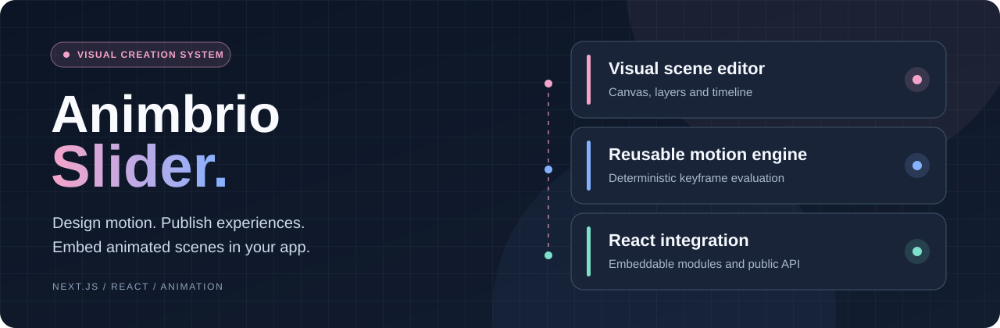

<p align="center"></p>

<h1 align="center">Animbrio Slider</h1>

<p align="center"><strong>Visual animation editor and embeddable React player</strong><br>Build an animated scene in the editor, publish a module and embed the player into a React application.</p>

<p align="center"><a href="README.fr.md">Lire en français</a> · <a href="#overview">Overview</a> · <a href="#features">Capabilities</a> · <a href="#architecture">Architecture</a> · <a href="#start">Get started</a> · <a href="#quality">Quality</a> · <a href="#faq">FAQ</a> · <a href="#license">License</a></p>

<p align="center"><a href="LICENSE"></a> </p>

<a id="overview"></a>
## Overview

**Animbrio Slider** is an open-source visual editor and React/Next.js renderer for animated hero sections, sliders and timeline-driven scenes. Its schema, animation engine and player are separated so the same scene document can be used for authoring and website playback.


**Intended users :** Frontend developers, web creators and product teams.

<a id="features"></a>
## Features

| Capability | Purpose |
| --- | --- |
| **Visual editor** | Canvas, layers, properties and keyframe timeline. |
| **Motion engine** | Deterministic scene evaluation at a requested point in time. |
| **React player** | Reusable ModulePlayer and ModuleStatic components. |
| **Project format** | Structured JSON schema validated with Zod. |
| **Web interactions** | Parallax, scroll timeline helpers and reduced-motion considerations. |
| **Publishing workflow** | Public API for published modules, separate from authoring endpoints. |

<a id="architecture"></a>
## Architecture

The pnpm monorepo contains apps/editor (Next.js editor), apps/integration-demo (Next.js integration example) and reusable packages: schema, animation-engine, interaction-engine, renderer, editor-core and persistence. React and Next.js integration guides explain how to embed modules.

<a id="start"></a>
## Quick start

Node.js 20+ and pnpm 9.15+ are required. Install dependencies, build the schema package and start the editor. The editor is configured on http://localhost:3840 and the integration demo on http://localhost:3841.


```bash
git clone https://github.com/hrmonic/animbrio-slider.git
cd animbrio-slider
pnpm install
pnpm --filter @animbrio/schema build
pnpm dev
```


Copy .env.example into apps/editor/.env.local if configuring API keys or custom data locations. Use pnpm dev:demo for the integration example, and pnpm -r run test / pnpm -r run build for local checks.

<a id="quality"></a>
## Quality and limitations

The repository includes tests in selected packages and a GitHub Actions workflow that builds and tests specific packages. Passing those checks is not equivalent to a cross-browser visual or accessibility audit.


### Limitations

- No public hosted demo is linked from the repository metadata yet.
- Runtime performance and reduced-motion accessibility should be evaluated in each web integration.
- Workspace packages are not necessarily individually published to npm.
- Review editor API key and access controls before exposing a self-hosted editor.


### Planned improvements

- Add authentic editor screenshots and scenes.
- Expand E2E testing of editing and playback.
- Document schema version stability and compatibility.

### Documentation

- [Architecture](docs/architecture.md)
- [Project JSON format](docs/project-format.md)
- [Next.js integration](docs/integration-nextjs.md)
- [React integration](docs/integration-react.md)
- [Contribution](CONTRIBUTING.md)

<a id="faq"></a>
## Frequently asked questions

### Can this render animations in React?

Yes. The repository includes React renderer components and integration documentation.

### Is WordPress required?

No. The editor and example use Next.js.

### Can published scenes be consumed separately?

The editor documents a public-module API distinct from authoring endpoints.

### Are packages available on npm?

They are provided as workspace packages; third-party publication should be verified separately.

<a id="license"></a>
## License

Released under the [Apache License 2.0](LICENSE).


**Maintainer :** [Réda Touzani (@hrmonic)](https://github.com/hrmonic).
