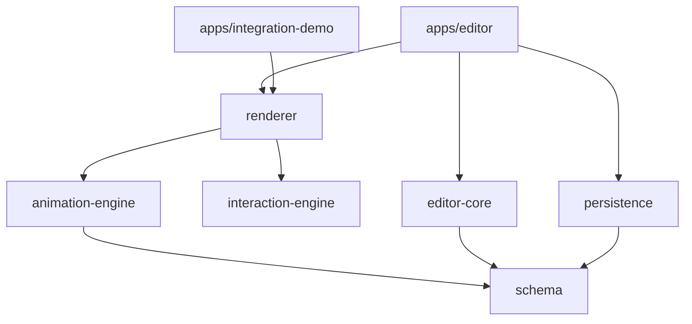

# Architecture

## Principles

1. **Monorepo (pnpm)** — shared packages consumed by the editor and any host app.
2. **Single engine** — `animation-engine`, `interaction-engine`, and `renderer` run the same logic in the editor and on the public site.
3. **Versioned schema** — `schemaVersion: 1` with `migrateProject()` for forward compatibility.
4. **Persistence** — `ProjectStore` interface: file-based JSON today; inject SQL via `createPostgresProjectStore`.
5. **Extensions** — parallax, scroll timeline, and optional renderer overlays (e.g. particles) stay behind explicit module settings.

## Publication flow

```
Editor (draft) → PUT /api/projects/:id
Publish action → copies draft to published + revisionHistory
GET /api/public/modules/:slug → published snapshot only
Host app → ModulePlayer(module, mediaById)
```

## Security model

- Editor routes require `x-animbrio-key` when `ANIMBRIO_API_KEY` is set.
- Public routes never expose draft documents.
- Media uploads are type-restricted and size-limited in the editor API.

## Package dependencies


